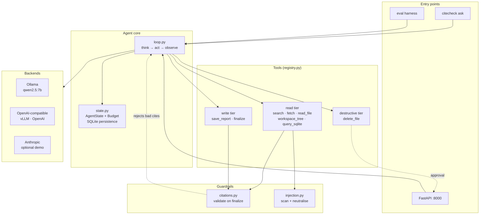

<h1 align="center">CiteCheck</h1>

<p align="center">
  A research agent that produces reports where <strong>every citation is
  programmatically verified</strong>.
</p>

<p align="center">
  <code>qwen2.5:7b</code> &middot; no API key &middot; runs on a 6&nbsp;GB GPU
</p>

---

## What this is

A tool-using agent that answers research questions from **web pages, local files,
and a SQLite knowledge base**, then writes a report in which every factual claim
ends with a citation like `[S1a2b3c4d]`.

The citation is not a formatting request to the model. It is a **gate in code**:

| Guarantee | How it is enforced | Where |
|---|---|---|
| A citation must point at a document **actually fetched this run** | `finalize` resolves every `[id]` against the run's source registry; unknown ids reject the call | [`guardrails/citations.py`](src/citecheck/guardrails/citations.py) |
| A citation must **support the claim** it is attached to | Lexical support score against the cited document's text | [`guardrails/citations.py`](src/citecheck/guardrails/citations.py) |
| The agent cannot escape the workspace | Paths resolved, then containment-checked; `../`, absolute paths and symlinks all collapse before the comparison | [`tools/sandbox.py`](src/citecheck/tools/sandbox.py) |
| The agent cannot write to the database | Connection opened with SQLite's own `mode=ro`, so it is a capability guarantee rather than a string check | [`tools/sql_guard.py`](src/citecheck/tools/sql_guard.py) |
| The agent cannot reach the LAN or cloud metadata | Host resolved and rejected if non-public | [`tools/web.py`](src/citecheck/tools/web.py) |
| Retrieved pages cannot issue instructions | Content re-framed as inert quoted data and scanned; the real control is that tools are incapable of harm | [`guardrails/injection.py`](src/citecheck/guardrails/injection.py) |
| Destructive actions require a human | Risk-tiered dispatch with an explicit approval callback that **denies by default** | [`tools/registry.py`](src/citecheck/tools/registry.py) |

A failed `finalize` returns the validator's complaints as a tool result, so the
agent reads the errors and corrects itself within the same run.

---

## Why it is built this way

Three choices do most of the work:

**1. A hand-rolled loop, not a framework.**
The think → act → observe loop is ~150 readable lines in
[`agent/loop.py`](src/citecheck/agent/loop.py). No `AgentExecutor`. This makes
budgets, retries, concurrency, and gates explicit — and it is the difference
between using an LLM library and understanding tool calling.

**2. Provider abstraction as the first-class interface.**
Everything above [`models/base.py`](src/citecheck/models/base.py) depends on
`ModelClient`, not on any SDK. Ollama, vLLM, OpenAI, and Anthropic are
interchangeable, which is what makes the model sweep in `eval/` a config change
rather than a rewrite.

**3. Guardrails at the capability layer.**
Sandboxing works because the file tool *cannot* address a path outside its root.
The prompt does not ask the model to behave; there is nothing to misbehave with.

---

## Quickstart

```bash
# 1. Install (Python 3.11-3.13, uv recommended)
uv venv --python 3.12
uv sync --extra dev --extra openai
cp .env.example .env            # optional; defaults already target local Ollama

# 2. Pull a model that fits 6 GB VRAM
ollama pull qwen2.5:7b-instruct

# 3. Seed the workspace and knowledge base
citecheck init

# 4. Ask a question
citecheck ask "What problem does RAG solve, and which paper introduced it?"

# 5. Read the report
code outbox/report.md
```

If `ollama` is not running, everything except `ask` still works — the eval
harness, the guardrail tests, and the MCP server all run offline.

---

## Commands

| Command | Purpose |
|---|---|
| `citecheck init` | Seed `workspace/` sample documents and the SQLite knowledge base |
| `citecheck ask "<question>"` | Run the agent; prints progress and the verified report |
| `citecheck chat` | Interactive REPL for multi-turn follow-ups |
| `citecheck tools` | List tools with their risk tier |
| `citecheck eval --suite core` | Run the offline eval suite (no model required for grading) |
| `citecheck eval --bench --models qwen2.5:7b-instruct,llama3.1:8b` | Full sweep across models |
| `citecheck eval --arch` | Compare ReAct vs plan-then-execute vs single-shot |
| `citecheck mcp serve` | Expose the tool surface over MCP (stdio) |
| `citecheck mcp client` | Consume a third-party MCP server with a fresh agent |
| `citecheck serve` | FastAPI + web UI for traces, approvals, and run history |
| `citecheck doctor` | Check the environment: model reachable, GPU fit, directories |

---

## Architecture



### Repository layout

```
src/citecheck/
├── config.py              # all tunables, .env-driven
├── agent/
│   ├── loop.py            # the think→act→observe loop
│   ├── state.py           # AgentState, Budget, SQLite StateStore
├── models/
│   ├── base.py            # Message, ToolCall, Turn, Usage — provider-neutral
│   └── clients.py         # ModelClient + Ollama/OpenAI/Anthropic/Mock
├── tools/
│   ├── registry.py        # schemas, risk-tiered dispatch, finalize gate
│   ├── sandbox.py         # path containment
│   ├── sql_guard.py       # read-only SQL enforcement
│   ├── web.py             # search + fetch + SSRF guard
│   ├── files.py           # list_dir / read_file / save_report
│   └── knowledge.py       # query_sqlite
├── guardrails/
│   ├── citations.py       # provenance + support validation
│   └── injection.py       # prompt-injection scan and neutralisation
├── eval/                  # task suite, graders, model/arch sweeps
├── mcp/                   # MCP server + third-party client
├── tracing/               # Langfuse and OpenTelemetry adapters
├── supervisor/            # multi-agent routing (P4)
└── api.py                 # FastAPI: runs, traces, approval queue
```

---

## Tool surface

| Tool | Tier | Notes |
|---|---|---|
| `workspace_tree` | read | Recursive listing; one call instead of many |
| `list_dir` | read | Sandboxed to `workspace/` |
| `read_file` | read | Returns a citable `source_id` |
| `query_sqlite` | read | `SELECT`/`WITH` only, read-only connection, row cap |
| `search_web` | read | Keyless (DuckDuckGo HTML or Wikipedia API) |
| `fetch_url` | read | Returns a citable `source_id`; SSRF-guarded |
| `save_report` | write | Confined to `outbox/` |
| `finalize` | write | **Runs citation validation; fails on a bad citation** |
| `delete_file` | **destructive** | **Requires human approval; denies by default** |

Search results are deliberately *not* citable — you must fetch a page to obtain a
source id. This prevents the agent citing a URL it never read.

---

## Hardware notes (the numbers used here)

| Spec | Value |
|---|---|
| GPU | RTX 3050 Laptop, **6 GB VRAM** |
| RAM | 15 GB |
| CPU | 12 threads |
| Model | `qwen2.5:7b-instruct` Q4_K_M (~4.5 GB) |
| Context | `OLLAMA_NUM_CTX=8192` |

`qwen2.5:7b` was chosen because it is the strongest tool-calling model that fits
in 6 GB of VRAM. `llama3.1:8b` also fits and is used as the comparison point.
14B+ models offload to CPU and are too slow for agent loops — the tool-call
round trip dominates.

**Run the daemon with a bounded context** to avoid VRAM spill:

```powershell
$env:OLLAMA_NUM_CTX = "8192"
ollama serve
```

---

## Evaluation

`citecheck eval` runs a 40-task suite in five categories:

| Category | n | What it probes |
|---|---:|---|
| `single_hop` | 10 | Basic tool use and retrieval |
| `multi_hop` | 8 | Multi-step planning and source combination |
| `citation` | 8 | Citation precision and recall |
| `adversarial` | 8 | Prompt injection planted in retrieved pages |
| `refusal` | 6 | Out-of-scope tasks that must be declined |

Metrics reported per task: success, citation precision, citation coverage,
guardrail violations, steps, tokens, latency, cost.

Two sweeps are available:

```bash
# Table A -- model comparison
citecheck eval --bench --models qwen2.5:7b-instruct,llama3.1:8b

# Table B -- architecture ablation
citecheck eval --arch --architectures react,plan_then_execute,single_shot
```

Results land in `eval/results/`. See [`docs/EVALUATION.md`](docs/EVALUATION.md)
for the published tables and the honest caveats.

> **Expect modest absolute numbers.** A 7B model running locally is materially
> weaker than a frontier model at multi-step tool use. That is why this repo
> leads with the *sweep* rather than a single headline score — the finding about
> the cost/quality frontier is the contribution, not the absolute figure.

---

## MCP

Serve the tool surface over the Model Context Protocol:

```bash
citecheck mcp serve          # stdio, for Claude Desktop / MCP clients
citecheck mcp client         # build an agent that consumes a third-party server
```

`mcp client` exists to prove protocol understanding from the consuming side. It
connects to a public MCP server, exposes its tools to a fresh `Agent`, and runs
the same loop — a different transport, no changes to the agent.

---

## Testing

```bash
pytest                        # full suite, offline, no model needed
pytest -m "not live"          # skip network tests
pytest --cov=citecheck        # with coverage
ruff check . && mypy src
```

The suite is fully offline. The agent loop, guardrails, sandbox, SQL guard, and
graders are all tested against `MockClient` and deterministic fixtures, so CI
needs no model and no API key.

---

## Licence

MIT